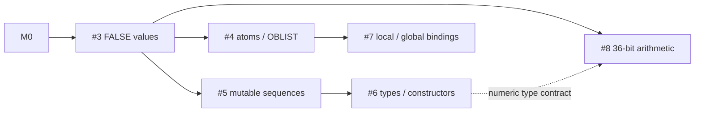
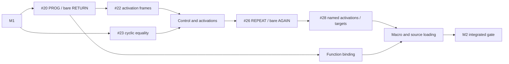

# Development roadmap: MDL on Racket and the 1977 Zork

## Definition of done

**Playable** means the original parser, rooms, objects, puzzles, NPC behaviors,
random events, state changes, and score execute in Racket from the chosen
reconstructed December 1977 source with documented differences. A synthetic
sample answering `LOOK` is NOT playable Zork.

**Faithful** means scenario and state-transition equivalence to a pinned
Confusion reference for every agreed regression case, including endgame to
500 points where possible. Byte-identical PDP-10 images are not required.

Each milestone has a separate issue/PR chain, a named gate, evidence, and
known limitations. Stop on failures instead of masking them.

## M0 — Proven reference and viable frontend for MDL source (PASS)

**Deliverables:** source lock; CI; source-located MDL AST reader; minimal
`#lang mdl`; native Confusion executable; capture scenario; diff harness;
manual and automated test documentation.

**Acceptance gate M0:**
- `make test` genuinely passes on an installed Racket toolchain.
- All relevant historical text files are attempted by the reader. Track
  individual failure files/offsets, add tests, and reach 100% parse coverage
  for the selected 1977 source set or explicitly gate as BLOCKED.
- Pinned Confusion source compiles and runs; opening scene + five commands
  captured with zero reference errors.
- A golden transcript has a written review/approval and traceable SHA.
- Semantic deltas between archive and playable reconstruction are listed.
- CI runs offline reader/harness tests; native reference job is available.

**Tasks:** #01 reader lexical coverage, #02 minimal macro/language loading,
#03 source manifest & provenance, #04 native Confusion build,
#05 reference PTY and transcripts, #06 M0 integration report.

## M1 — MDL semantic micro-runtime (PASS)

**Build:** atom identity/OBLIST, truth and FALSE, local/global environments,
mutable LIST/VECTOR/UVECTOR with shared views, `NEWTYPE`/`CHTYPE`, 36-bit
operations, evaluation order, structural and identity equality.

**Gate:** independent primitive tests corroborated by Confusion scripts;
property and mutation-aliasing tests; no unsupported fallthrough.

**Tasks:** #07 values/false/atoms, #08 mutable sequence and identity,
#09 types and data constructors, #10 global bindings, #11 bit arithmetic.

### M1 issue order and dependencies

| GitHub issue | Vertical slice | Depends on |
|---|---|---|
| [#3](https://github.com/quaat/mdl-racket/issues/3) | First-class FALSE values, first part of task #07 | M0 |
| [#4](https://github.com/quaat/mdl-racket/issues/4) | Atom identity and OBLIST, rest of task #07 | #3 |
| [#5](https://github.com/quaat/mdl-racket/issues/5) | Mutable sequences and shared REST views, task #08 | #3 |
| [#6](https://github.com/quaat/mdl-racket/issues/6) | Types and constructors, task #09 | #3, #5 |
| [#7](https://github.com/quaat/mdl-racket/issues/7) | Local/global bindings, task #10 | #3, #4 |
| [#8](https://github.com/quaat/mdl-racket/issues/8) | 36-bit arithmetic, task #11 | #3; coordinate numeric tags with #6 |

Begin with only the FALSE/value primitive in #3. Close each issue on its own
Confusion-backed tests and evidence; this graph is planning, not a claim that
later semantics are already implemented.

## M2 — Execution semantics and MDL compilation (CURRENT)

The [G0 source-readiness audit](evidence/M2/SOURCE-READINESS.md),
[G1 shared-session source loader](evidence/M2/SOURCE-LOADER.md), and
[G2 original VFLOAD probe](evidence/M2/HISTORICAL-VFLOAD.md) pass.
On the stacked `feat/m2-mapf` branch, [G3 original-definition execution](evidence/M2/G3-GATE-MAPF.md)
passes 59 assertions. This is a branch result. The indirect
APPLY/DISPATCH correction for issue #69 and the
[requirements audit](evidence/M2/REQUIREMENTS-AUDIT.md) are recorded on a
child branch. M2 still requires final-head CI and review, authorized
integration, and mainline verification. The complete historical
loader separately stops at `EMPTY?` after 24 completed forms. Prior FAIL
decisions and their exact blockers remain in [the dated G3 report](evidence/M2/G3-GATE.md)
and [status history](STATUS.md).

**Build:** `DEFINE` formal arguments including OPTIONAL/AUX/TUPLE,
`DEFMAC`, `COND`, `PROG`, `REPEAT`, `RETURN`, `AGAIN`, `MAPF`, `UNWIND`,
indirect APPLY/DISPATCH, declarations, runtime macro expansion,
loading/linking across source files.

**Gate:** structured tests and original MDL source can execute initial
source definitions, with no loss of semantic aliasing/continuations.

**Tasks:** #12 control flow and activation records, #13 macros,
#14 function application/binding, #15 source loader, #16 random/event APIs.

### M2 first slice and dependency order

| Work item | Scope | Depends on |
|---|---|---|
| [Issue #20](https://github.com/quaat/mdl-racket/issues/20) | Unnamed PROG auxiliaries and bare RETURN in the current function | M1 |
| [Issue #22](https://github.com/quaat/mdl-racket/issues/22) | Explicit activation frames, function ownership, and lifetime | #20 |
| [Issue #23](https://github.com/quaat/mdl-racket/issues/23) | Terminating structural equality on cyclic mutable values | M1 equality; before broader execution |
| [Issue #26](https://github.com/quaat/mdl-racket/issues/26) | Unnamed REPEAT and bare AGAIN within the current function | #22, #23 |
| [Issue #28](https://github.com/quaat/mdl-racket/issues/28) | Named PROG/REPEAT activations and explicit target RETURN/AGAIN | #26 |
| Later control slice | Function activation formals, GO, UNWIND | #28; coordinate with function binding |
| Function binding slice | OPTIONAL/AUX/TUPLE and application/activation semantics | #20; coordinate with control slice |
| Macro and loader slices | DEFMAC expansion, cross-file loading, initial original source definitions | Function binding and control slices |
| Integrated gate | Structured tests and original definitions execute without lost aliasing or continuations | Prior M2 slices |

Issue #20 is a local slice, not an M2 gate pass. The later work items are
proposed dependencies; create focused issues when their semantics and tests
are ready to review.

## M3 — Actual 1977 game boots in Racket

**Build:** world structures (`defs`, `makstr`, `dung`), vocabulary,
`np` original parser, actions, room logic, game loop, I/O abstraction.

**Gate:** in Racket, with the original reconstructed source, the house-smoke
transcript matches approved Confusion output (except explicitly adjudicated
format differences). Save/restore and event seed handling are documented.

**Tasks:** #17 world model, #18 command parser, #19 actions, #20 loop/IO,
#21 initial differential test.

## M4 — Comprehensive behavioral equivalence

**Build:** scripted paths across map/puzzles; inventory, game death,
NPCs, lamp/timers, parser edge cases, randomness, scoring, save/restore,
500-point completion. Instrument read-only debug state in BOTH engines where
feasible; transcript alone is necessary but insufficient.

**Gate:** reference scenarios and state snapshots have passing diff reports;
accepted exceptions are source-justified; completing-game run verified.

**Tasks:** #22 scenario corpus, #23 state schema, #24 deterministic RNG,
#25 complete-game test, #26 save/restore parity, #27 security review.

## M5 — Browser application (server-backed first)

**Build:** isolated Racket game sessions, API, accessible retro terminal UI,
command history, persistence, optional inventory/map, restart, CI deployment.
Forbid raw MDL evaluation exposed to browser clients.

**Gate:** multiplayer isolation, input validation, save/restore, accessible
keyboard UI, mobile layout, no regression against game oracle.

**Tasks:** #28 session service, #29 terminal UI, #30 saves, #31 accessibility,
#32 production limits.

## M6 — Optional client-side/browser runtime

Investigate Racket/WebAssembly/JavaScript subset compatibility. Treat this as
**an experiment** and don't make MVP dependent on it. If unsuitable, keep the
server-backed application and document the architecture decision.

**Gate:** actual browser running original MDL game logic without a server,
including a save/restore cycle, if and only if practical.

## Cross-cutting experiment design

- Reference and candidate comparison uses exactly the same command sequence,
  game version, flags, random state, and output normalization contract.
- Source version, toolchain, OS, seed strategy, scenario ID, and any deliberate
  patch must be documented with each evidence bundle.
- Prefer PRs with a small semantic surface, one failing-before/passing-after
  test, and rollback capability.
- A separate future paper/research track can compare native Confusion,
  Racket interpretation, and translated Racket runtime performance.
