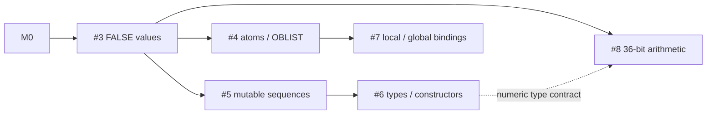
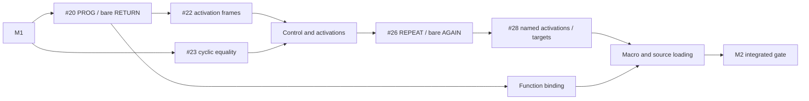

# Development roadmap: MDL on Racket and the 1977 Zork

## Definition of done

**Playable** means the original parser, rooms, objects, puzzles, NPC behaviors,
random events, state changes, and score execute in Racket from the chosen
reconstructed December 1977 source with documented differences. A synthetic
sample answering `LOOK` is NOT playable Zork.

**Faithful** means scenario and state-transition equivalence to a pinned
Confusion reference for every agreed regression case, including endgame to
500 points where possible. Byte-identical PDP-10 images are not required.

Each milestone has a separate issue/PR chain, a named gate, evidence, and
known limitations. Stop on failures instead of masking them.

## M0 — Proven reference and viable frontend for MDL source (PASS)

**Deliverables:** source lock; CI; source-located MDL AST reader; minimal
`#lang mdl`; native Confusion executable; capture scenario; diff harness;
manual and automated test documentation.

**Acceptance gate M0:**
- `make test` genuinely passes on an installed Racket toolchain.
- All relevant historical text files are attempted by the reader. Track
  individual failure files/offsets, add tests, and reach 100% parse coverage
  for the selected 1977 source set or explicitly gate as BLOCKED.
- Pinned Confusion source compiles and runs; opening scene + five commands
  captured with zero reference errors.
- A golden transcript has a written review/approval and traceable SHA.
- Semantic deltas between archive and playable reconstruction are listed.
- CI runs offline reader/harness tests; native reference job is available.

**Tasks:** #01 reader lexical coverage, #02 minimal macro/language loading,
#03 source manifest & provenance, #04 native Confusion build,
#05 reference PTY and transcripts, #06 M0 integration report.

## M1 — MDL semantic micro-runtime (PASS)

**Build:** atom identity/OBLIST, truth and FALSE, local/global environments,
mutable LIST/VECTOR/UVECTOR with shared views, `NEWTYPE`/`CHTYPE`, 36-bit
operations, evaluation order, structural and identity equality.

**Gate:** independent primitive tests corroborated by Confusion scripts;
property and mutation-aliasing tests; no unsupported fallthrough.

**Tasks:** #07 values/false/atoms, #08 mutable sequence and identity,
#09 types and data constructors, #10 global bindings, #11 bit arithmetic.

### M1 issue order and dependencies

| GitHub issue | Vertical slice | Depends on |
|---|---|---|
| [#3](https://github.com/quaat/mdl-racket/issues/3) | First-class FALSE values, first part of task #07 | M0 |
| [#4](https://github.com/quaat/mdl-racket/issues/4) | Atom identity and OBLIST, rest of task #07 | #3 |
| [#5](https://github.com/quaat/mdl-racket/issues/5) | Mutable sequences and shared REST views, task #08 | #3 |
| [#6](https://github.com/quaat/mdl-racket/issues/6) | Types and constructors, task #09 | #3, #5 |
| [#7](https://github.com/quaat/mdl-racket/issues/7) | Local/global bindings, task #10 | #3, #4 |
| [#8](https://github.com/quaat/mdl-racket/issues/8) | 36-bit arithmetic, task #11 | #3; coordinate numeric tags with #6 |

Begin with only the FALSE/value primitive in #3. Close each issue on its own
Confusion-backed tests and evidence; this graph is planning, not a claim that
later semantics are already implemented.

## M2 — Execution semantics and MDL compilation (PASS)

The [G0 source-readiness audit](evidence/M2/SOURCE-READINESS.md),
[G1 shared-session source loader](evidence/M2/SOURCE-LOADER.md), and
[G2 original VFLOAD probe](evidence/M2/HISTORICAL-VFLOAD.md) pass.
The [mainline gate](evidence/M2/MAINLINE-GATE.md) passes at the integrated
`main` code baseline `7d34195`, including 59 original-definition G3
assertions and the [requirements audit](evidence/M2/REQUIREMENTS-AUDIT.md).
The complete historical loader separately stops at `EMPTY?` after 24
completed forms. Prior FAIL decisions remain in the [dated G3 report](evidence/M2/G3-GATE.md)
and [status history](STATUS.md).

**Build:** `DEFINE` formal arguments including OPTIONAL/AUX/TUPLE,
`DEFMAC`, `COND`, `PROG`, `REPEAT`, `RETURN`, `AGAIN`, `MAPF`, `UNWIND`,
indirect APPLY/DISPATCH, declarations, runtime macro expansion,
loading/linking across source files.

**Gate:** structured tests and original MDL source can execute initial
source definitions, with no loss of semantic aliasing/continuations.

**Tasks:** #12 control flow and activation records, #13 macros,
#14 function application/binding, #15 source loader. The earlier task-list
entry “#16 random/event APIs” was outside this milestone's stated Build
and Gate; it is now explicitly assigned to
[M3 issue #71](https://github.com/quaat/mdl-racket/issues/71), where
unchanged game source and reference observations can define its behavior.
See ADR-0030 in `docs/DECISIONS.md`. M2 PASS makes no claim about random
or event runtime parity.

### M2 first slice and dependency order

| Work item | Scope | Depends on |
|---|---|---|
| [Issue #20](https://github.com/quaat/mdl-racket/issues/20) | Unnamed PROG auxiliaries and bare RETURN in the current function | M1 |
| [Issue #22](https://github.com/quaat/mdl-racket/issues/22) | Explicit activation frames, function ownership, and lifetime | #20 |
| [Issue #23](https://github.com/quaat/mdl-racket/issues/23) | Terminating structural equality on cyclic mutable values | M1 equality; before broader execution |
| [Issue #26](https://github.com/quaat/mdl-racket/issues/26) | Unnamed REPEAT and bare AGAIN within the current function | #22, #23 |
| [Issue #28](https://github.com/quaat/mdl-racket/issues/28) | Named PROG/REPEAT activations and explicit target RETURN/AGAIN | #26 |
| Later control slice | Function activation formals, GO, UNWIND | #28; coordinate with function binding |
| Function binding slice | OPTIONAL/AUX/TUPLE and application/activation semantics | #20; coordinate with control slice |
| Macro and loader slices | DEFMAC expansion, cross-file loading, initial original source definitions | Function binding and control slices |
| Integrated gate | Structured tests and original definitions execute without lost aliasing or continuations | Prior M2 slices |

Issue #20 is a local slice, not an M2 gate pass. The later work items are
proposed dependencies; create focused issues when their semantics and tests
are ready to review.

## M3 — Actual 1977 game boots in Racket

**Current frontier (2026-11-23; branch stack, not `main`):** the unchanged
`77loadall.mud` chain completes all 1,229 original forms with zero skips
(scoped LOADED PASS on the umbrella `feat/m3-logical-gc`, PR #107). On the
stack head `feat/m3-interactive-io` (PR #141, `45c387f`) the faithful
`run.mud` path, `<FLOAD "77loadall.mud">` then `<SAVE-IT>`, completes
startup in-session (SAVE is an in-session record per ADR-0048; RESET,
PRINC, PRIN1, READSTRING and the local host loop per ADR-0050), and the six
house-boot commands play through the original RDCOM: scoped INITIALIZED
and INTERACTIVE PASS (`make test-m3-interactive`; end of input terminates
with the strict `exn:fail:mdl-input-exhausted`). SMOKE_PARITY is NOT RUN:
the date line and the `west` text (`<PROB 80>`, 77rooms.mud:523) depend on
the host clock until a session-owned fixed clock exists (#135). A direct
call to START still stops at TENEX? because it bypasses GETSYS; that is a
retained direct-START XFAIL, not the frontier. `main` (`fdf48e4`) is still
at LOADED FAIL (433 forms). `scripts/m3_source_progress.py` does not run
SAVE-IT and still reports INITIALIZED/INTERACTIVE false. M3 PASS requires
the approved house smoke scenario, not just startup. See
[S7 evidence](evidence/M3/S7-INTERACTIVE.md), [STATUS](STATUS.md) and the
earlier [WIP evidence](evidence/M3/WIP-SOURCE-LOAD.md).

The first source-progress gate is `make m3-source-progress`. It runs the
unchanged `77loadall.mud` entry, accepts a new genuine source dependency
only when the first 24 original expressions remain intact, and records a
machine-readable file/order/failure report. The M2 regression suite loads
an explicit SHA-verified original-source prefix and does not pin the
full loader to its former EMPTY? failure. See
[`SOURCE-PROGRESS.md`](evidence/M3/SOURCE-PROGRESS.md). The initial
M3 observation was 24 completed, zero skipped forms; EMPTY? was first.

**Build:** world structures (`defs`, `makstr`, `dung`), vocabulary,
`np` original parser, actions, room logic, game loop, I/O abstraction.

**Gate:** in Racket, with the original reconstructed source, the house-smoke
transcript matches approved Confusion output (except explicitly adjudicated
format differences). Save/restore and event seed handling are documented.

**Tasks:** #17 world model, #18 command parser, #19 actions, #20 loop/IO,
#21 initial differential test.

### Active iteration (2026-11-23)

> **Outcome (2026-11-23):** M3 accepted on `main` (`2a86d5d`): SMOKE_PARITY
> PASS (scoped) and local session smoke PASS; PLAYABLE NOT RUN
> ([acceptance record](evidence/M3/M3-MAINLINE-ACCEPTANCE.md)). WP1-WP4 are
> done; WP5 continues as M4 with the scenario "enter the house and open the
> cellar".

Work packages for the current iteration. They do not change the milestone
definitions or gates above. **M3 formal acceptance** = the deterministic,
approved house smoke transcript (WP2) plus documented deviations. A local
session smoke (WP4) is **not** PLAYABLE and not M3 acceptance.

- **WP1 — stack readiness.**
  - F1 (done on #141, 8e3d103/0e9dafe): the reference workflow runs
    `make test-m3-saveit` and `make test-m3-interactive` with step time
    limits and retained logs; the smoke workflow runs the shared
    `make test-python`. A deliberate golden mismatch failed CI run
    45150256893 at the six-command step.
  - F2 (done on #141, 8e3d103): the host loop's final flush never replaces
    the failure leaving the loop; flush failures are reported as
    `(flush-failed exn)` events
    ([F1/F2 record](evidence/M3/F1-F2-STACK-FIXES.md)).
  - F3: documentation consolidation (this reconciliation: present-tense
    SEMANTICS/STATUS/PLAN/README/inventory match the code).
  - #55: agent-configuration revision (done: provider-neutral roles,
    `model: inherit`).
- **WP2 — deterministic fresh-boot SMOKE_PARITY (#131, #135).**
  Host-injected, session-owned clock with epoch 250776000 (UTC); a proof
  chain clock → DSKDATE → START seed → RNG; immutable boot inputs separated
  from SAVE side effects; a strict comparator with negative checks; a
  `make m3-check` aggregate target. **Done on branch (#144, #146):**
  SMOKE_PARITY PASS (branch evidence, scoped); see STATUS.
- **WP3 — session dependencies.** MEMBER, including STRING substring
  search; QUIT per ADR-0051 as a raised non-`exn:fail` session signal; OPEN
  denial that returns a FALSE with reason, file-spec and status chosen so
  RECORD avoids its `*600130*` busy branch (CLOSE stays unsupported);
  READSTRING `!` escape per pinned Confusion; an explicit output port for
  game sessions. Each needs a SEMANTICS entry and reference probes first.
  **Status:** MEMBER (#145), QUIT and OPEN (#147) done on branch;
  READSTRING `!` and explicit output ports done (#150).
- **WP4 — local session smoke and launcher.** A scenario covering
  `quit` answered n, continue, then `quit` answered y, with no file writes;
  a thin CLI/DrRacket launcher over `make-mdl-session` and
  `mdl-session-run-interactive`. No raw REPL, no web service.
  **Done on branch (#147, #148):** local session smoke PASS (branch
  evidence).
- **WP5 — M4 scenario backlog.** Collect scenarios for the M4 corpus as a
  backlog only; M4 gate work waits for M3 acceptance (AGENTS.md step 9).
  Draft: [M4 scenario backlog](evidence/M4/SCENARIO-BACKLOG.md) (first
  scenario: enter the house and open the cellar).

## M4 — Comprehensive behavioral equivalence

> **Progress (2026-11-23, `main` = `c8964bf`):** scenarios S1 (house and
> cellar), S2 (SEGMENT / drop) and S3 (CHARACTER / orphan prompts) PASS on
> mainline, scenario-scoped ([baseline](evidence/M4/M4-MAINLINE-BASELINE.md)).
> The M4 gate itself is NOT YET PASSED. Next slices, each separately
> reviewable: S4 TOP and the parser path (`77np.mud:126`); S5 MAX (#122) and
> weapon combat with the troll; then corpus expansion (parser ambiguity,
> death/recovery, scoring/inventory, lamp countdown and clock events).

**Build:** scripted paths across map/puzzles; inventory, game death,
NPCs, lamp/timers, parser edge cases, randomness, scoring, save/restore,
500-point completion. Instrument read-only debug state in BOTH engines where
feasible; transcript alone is necessary but insufficient.

**Gate:** reference scenarios and state snapshots have passing diff reports;
accepted exceptions are source-justified; completing-game run verified.

**Tasks:** #22 scenario corpus, #23 state schema, #24 deterministic RNG,
#25 complete-game test, #26 save/restore parity, #27 security review.

## M5 — Browser application (server-backed first)

**Build:** isolated Racket game sessions, API, accessible retro terminal UI,
command history, persistence, optional inventory/map, restart, CI deployment.
Forbid raw MDL evaluation exposed to browser clients.

**Gate:** multiplayer isolation, input validation, save/restore, accessible
keyboard UI, mobile layout, no regression against game oracle.

**Tasks:** #28 session service, #29 terminal UI, #30 saves, #31 accessibility,
#32 production limits.

## M6 — Optional client-side/browser runtime

Investigate Racket/WebAssembly/JavaScript subset compatibility. Treat this as
**an experiment** and don't make MVP dependent on it. If unsuitable, keep the
server-backed application and document the architecture decision.

**Gate:** actual browser running original MDL game logic without a server,
including a save/restore cycle, if and only if practical.

## Cross-cutting experiment design

- Reference and candidate comparison uses exactly the same command sequence,
  game version, flags, random state, and output normalization contract.
- Source version, toolchain, OS, seed strategy, scenario ID, and any deliberate
  patch must be documented with each evidence bundle.
- Prefer PRs with a small semantic surface, one failing-before/passing-after
  test, and rollback capability.
- A separate future paper/research track can compare native Confusion,
  Racket interpretation, and translated Racket runtime performance.
